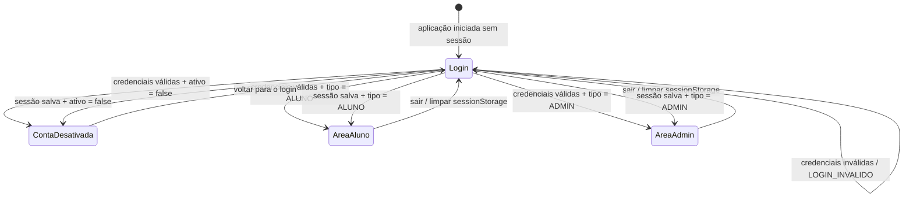
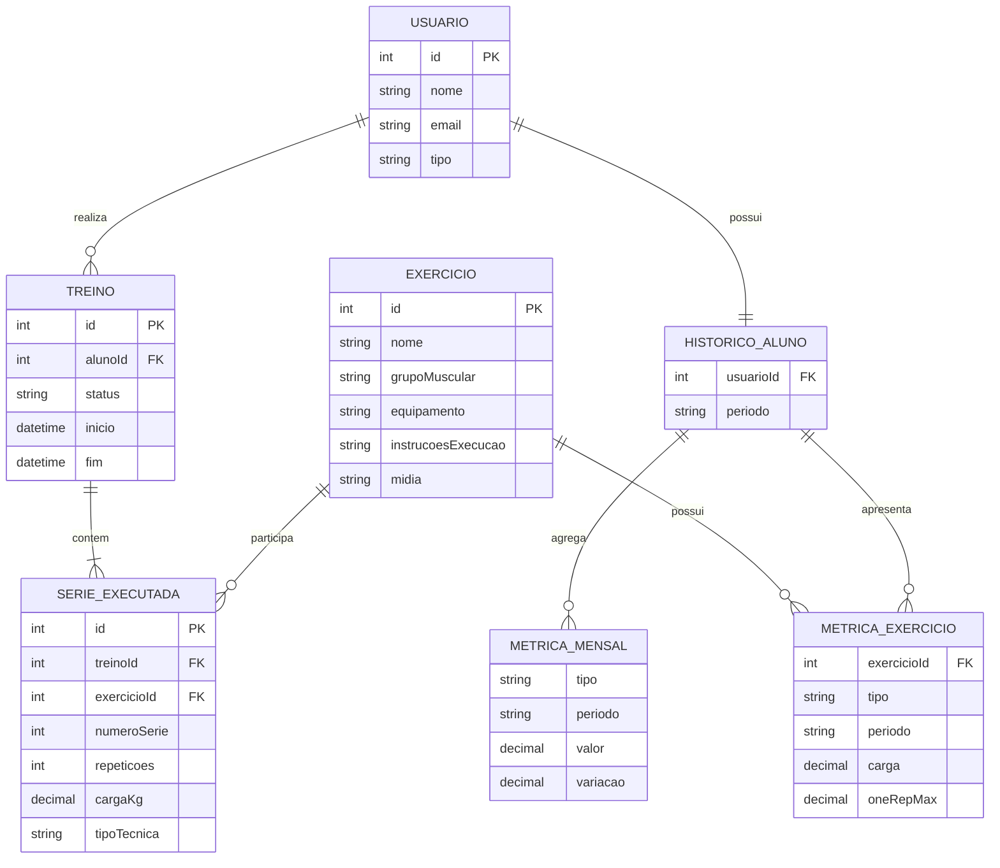

# Repositório para o Trabalho de Programação orientada a Objetos para Desenvolvimento - Rep_Max

Esse repositório será usado para versionar e controlar nosso processo de aprendizado enquanto desenvolvemos o projeto. 

# Introdução:
O Rep Max será um Sistema de Log Book de Treino de Academia. Ele resolverá os problemas listados abaixo:

<ul >
  <li>Ausência de um histórico organizado de séries, repetições e cargas utilizadas em cada treino;</li>
  <li>Dificuldade de identificar se um exercício está em progressão, estagnação ou regressão de desempenho;</li>
  <li>Falta de suporte para técnicas de intensificação de treino (bi-set, tri-set, monster set e drop set), que hoje são anotadas de forma manual e pouco estruturada;</li>
  <li>Dúvidas frequentes sobre a execução correta de determinados exercícios, sem uma referência disponível no momento do treino;</li>
  <li>Ausência de um canal integrado entre aluno e personal trainer, que hoje depende de aplicativos de mensagens externos (como WhatsApp) e planilhas avulsas.</li>
</ul>
Como o repMax resolve isso é detalhado na documentação.

# Quem está fazendo esse projeto:

O Projeto é feito pela dupla de alunos: Zadoque Pires de Deus Souza Carneiro (vulgo EU) e Artur Pereira da Silva. Embora no histórico do github aqui só eu esteja commitando agora nesse exato o momento, Artur já fez boa parta da documentação no que tange a API RESTfull, requisitos, orçamento, etc. O que explica o fato de que eu não vou (espero pelo menos) levar a noite toda para terminar essa parte. 

# Uso de IA nesse projeto:

> [!WARNING]
> Totalmente desencorajado pelo nosso querido professor. Isso tem como objetivo que realmente possamos aprender os conceitos. A IA será usada expressamente apenas para fazer auditoria, não modificação, e também para criação de commits descritivos, sempre validados e corrigidos caso fiquem genéricos.

# Uso de Framework e Soluçõe prontas em geral:

> [!WARNING]
> Mesmo caso da IA, totalmente desencorado também pelo nosso querido professor. Embora tenhamos conseguido negociar o uso de Spring Boot para a API RESTfull, não chegamos a validar o uso de um framework para a interface WEB. Mas vamos marcar uma reunião com nosso AD Hoc e resolver essa pendência. Na documentação eu já vou colocar planejado e justificado, mas ainda vou passar pela régua do supervisor.

# Convenções e organização do Front-end

O front-end segue convenções de nomenclatura e uma organização por responsabilidade. A ideia é tornar os arquivos fáceis de localizar, importar e reutilizar, mantendo uma leitura consistente em todo o projeto.

## Componentes React

Componentes React utilizam **PascalCase**, tanto no nome do arquivo quanto no nome da função ou classe exportada. O nome deve representar claramente a responsabilidade do componente.

| Responsabilidade | Exemplo no projeto |
| --- | --- |
| Página | `src/pages/LoginPage.tsx`, `src/pages/AlunoHomePage.tsx` |
| Componente de navegação | `src/components/navegacao/NavegacaoPrincipal.tsx` |
| Componente de rota | `src/components/rotas/RotaAluno.tsx` |
| Componente de aba | `src/components/abas/HistoricoTab.tsx`, `src/components/abas/TreinosTab.tsx` |
| Componente visual reutilizável | `src/components/exercicios/ExercicioAnimacao.tsx` |

Exemplo:

```tsx
export default function ExercicioAnimacao({ exercicio }: Props) {
  // comportamento visual da animação do exercício
}
```

## Arquivos TypeScript

Arquivos `.ts` que não são componentes utilizam **kebab-case**. Essa convenção é aplicada a serviços, tipos, hooks, contextos, mocks e utilitários.

| Tipo de arquivo | Exemplos no projeto |
| --- | --- |
| Serviço | `src/services/aluno-dashboard.ts`, `src/services/preferencias-usuario.ts` |
| Tipos | `src/types/usuario-logado.ts`, `src/types/aluno-dashboard.ts` |
| Hook | `src/hooks/use-autenticacao.ts`, `src/hooks/use-tema.ts` |
| Contexto | `src/contexts/autenticacao-context.ts` |
| Mock | `src/mocks/usuarios-mock.ts`, `src/mocks/exercicios-mock.ts` |
| Utilitário | `src/utils/normalizar-email.ts`, `src/utils/validacao-email.ts` |

Exemplo de serviço separado da interface:

```ts
export async function buscarExercicios(): Promise<ExercicioCatalogo[]> {
  if (import.meta.env.VITE_USE_MOCK === "true") {
    return exerciciosMock
  }

  // Integração futura com GET /api/exercicios
}
```

## Organização por responsabilidade

As pastas refletem o papel de cada parte da aplicação:

```text
src/
├── components/   # componentes visuais e de navegação
├── contexts/     # estado compartilhado, como autenticação
├── hooks/        # lógica reutilizável entre componentes
├── mocks/        # dados fictícios para desenvolvimento
├── pages/        # páginas acessadas pelas rotas
├── services/     # comunicação e regras de acesso aos dados
├── types/        # contratos TypeScript
└── utils/        # funções auxiliares
```

Por exemplo, `LoginPage.tsx` coleta as credenciais e delega a autenticação para `services/autenticacao.ts`. O resultado é armazenado pelo `AutenticacaoProvider`, enquanto `RotaAluno.tsx` usa esse estado para proteger a área `/app`. Dessa forma, a página, o estado global e a regra de navegação permanecem separados.

# Padrão de Commits

O projeto utiliza o padrão **Conventional Commits** para manter o histórico do Git organizado, previsível e fácil de consultar. Cada mensagem deve informar de forma breve qual tipo de mudança foi realizada e, opcionalmente, a área afetada:

```text
tipo(escopo): descrição curta no imperativo
```

## Tipos utilizados

| Tipo | Quando utilizar | Exemplo no projeto |
| --- | --- | --- |
| `feat` | Adição de uma funcionalidade | `feat(frontend): add exercise animation controls` |
| `fix` | Correção de um comportamento incorreto | `fix(auth): normalize login emails` |
| `docs` | Alteração exclusiva de documentação | `docs(readme): document frontend flows and entities` |
| `refactor` | Reorganização sem mudar o comportamento | `refactor(services): isolate dashboard data access` |
| `test` | Criação ou alteração de testes | `test(auth): cover inactive account login` |
| `chore` | Manutenção, configuração ou dependências | `chore(frontend): update build configuration` |

## Regras práticas

- Escrever a descrição em inglês e no imperativo: `add`, `fix`, `document`, `update`;
- Manter a primeira linha curta e objetiva;
- Usar escopo quando ele ajudar a identificar a área alterada, como `frontend`, `auth`, `readme` ou `services`;
- Não misturar funcionalidades diferentes no mesmo commit;
- Usar o corpo do commit somente quando for necessário explicar contexto, decisão técnica ou impacto;
- Indicar breaking changes com `!`, por exemplo: `feat(api)!: change authentication response contract`.

Exemplo de commit deste projeto:

```text
docs(readme): document frontend flows and entities
```

Como referência para esse padrão, consulte o vídeo [Conventional Commits](https://www.youtube.com/watch?v=P_DeVtGP3VE).

# Fase 1:
## Documentação e Requisitos:
Dentro da pasta documentacao, tem o arquivo main.tex e o compilado dele main.pd que define os requisitos e arquitetura do projeto com justificativas.

# Fase 2: Desenvolvimento do Front-End com Dados Mocados

<br>

<blockquote>
  <strong>💡 O que é esta fase?</strong><br>
  Construção das telas e componentes visuais utilizando dados fictícios (mocks) estruturados, simulando o comportamento real do sistema.
</blockquote>

<br>

<details>
  <summary><strong>🧠 Por que usamos essa estratégia?</strong></summary>
  <br>
  
  <table>
    <thead>
      <tr>
        <th>Benefício</th>
        <th>Descrição</th>
      </tr>
    </thead>
    <tbody>
      <tr>
        <td><strong>⚡ Feedback Rápido (Fail Fast)</strong></td>
        <td>O cliente ou os stakeholders conseguem interagir com uma interface realista logo nas primeiras Sprints. Se algo precisar mudar no design ou no fluxo, a alteração é feita rapidamente na camada visual.</td>
      </tr>
      <tr>
        <td><strong>🔄 Paralelismo de Equipes</strong></td>
        <td>Assim que a estrutura de dados (o contrato da API) é definida, a equipe de front-end pode construir as telas com mocks, enquanto a equipe de back-end desenvolve as APIs reais em paralelo. Ninguém fica esperando por ninguém.</td>
      </tr>
      <tr>
        <td><strong>📉 Redução de Desperdício</strong></td>
        <td>Descobrir que uma funcionalidade não faz sentido depois que o banco de dados e as APIs já estão prontos gera um custo de refatoração altíssimo. Com o mock, o desperdício de código é mínimo.</td>
      </tr>
      <tr>
        <td><strong>🧪 Testabilidade Antecipada</strong></td>
        <td>Permite criar testes de interface (E2E) e de componentes desde o primeiro dia, garantindo que o comportamento visual esteja correto.</td>
      </tr>
    </tbody>
  </table>
  </details>

## Front-end atual

O front-end agora possui uma área autenticada mobile-first para alunos, construída com React, Vite e Tailwind CSS.

### Autenticação e sessão

- Login com usuários mockados e contas ativas/inativas;
- persistência da sessão com `sessionStorage`;
- logout nas áreas de aluno e administrador;
- proteção de rotas para aluno, administrador e conta desativada;
- preferência de tema claro/escuro persistida globalmente no `localStorage`;
- alteração da preferência preparada em um serviço mockado com o caminho `PATCH /api/usuarios/{id}/preferencia-tema`.

#### Autômato finito determinístico do login

O fluxo de autenticação pode ser representado como um autômato finito determinístico. Cada estado corresponde a uma tela ou situação da sessão, e cada transição é causada por uma leitura do formulário, pelo resultado da autenticação ou por uma ação de navegação.



| Estado | Tela ou destino | Entrada lida |
| --- | --- | --- |
| `Login` | `/login` | Aplicação iniciada sem usuário autenticado ou credenciais inválidas |
| `ContaDesativada` | `/desativado` | Usuário encontrado, mas com `ativo = false` |
| `AreaAluno` | `/app` | Usuário autenticado com `tipo = ALUNO` |
| `AreaAdmin` | `/admin` | Usuário autenticado com `tipo = ADMIN` |

Quando o login é concluído, o usuário é salvo no `sessionStorage`. Em uma nova leitura da aplicação, esse valor é usado para decidir diretamente entre `/app`, `/admin` e `/desativado`. Credenciais inválidas não mudam de tela: o autômato permanece em `/login` e exibe a mensagem de erro.

### Área do aluno

A área `/app` possui quatro abas:

- **Início:** próximo treino ou treino pausado para continuar;
- **Treinos:** rotinas salvas do usuário;
- **Histórico:** métricas mensais de volume total, 1RM estimado e séries/repetições; evolução de carga e 1RM selecionável por exercício; histórico de treinos realizados;
- **Perfil:** e-mail, foto, peso, altura, notificações e preferência de tema.

### Catálogo de exercícios e histórico

O front-end possui um catálogo mockado com 50 exercícios comuns de academia. Cada exercício segue o modelo previsto no back-end, com identificador, nome, grupo muscular, equipamento, descrição, instruções e mídia. As métricas de carga e 1RM são vinculadas ao `exercicioId` e apresentam a evolução organizada por mês.

#### Diagrama conceitual de entidades

O relacionamento entre o catálogo de exercícios e o histórico pode ser visualizado abaixo. Um usuário registra treinos; cada treino possui séries executadas; e cada série referencia um exercício. As métricas de histórico são agregações calculadas a partir dessas séries e agrupadas por exercício e período.



No frontend, `HistoricoAluno` reúne as métricas gerais, as métricas específicas de cada exercício e a lista de treinos realizados. A entidade `SerieExecutada` representa a origem dos valores de volume, carga e 1RM; `MetricaExercicio` representa a evolução desses valores para um `exercicioId` selecionado.

As consultas são isoladas em serviços (`buscarExercicios` e `buscarHistoricoAluno`) e condicionadas por `VITE_USE_MOCK`. Assim, a troca para `false` mantém o contrato pronto para os endpoints da API, atualmente documentados como `GET /api/exercicios` e `GET /api/alunos/{id}/progresso/{exercicioId}`.

As demonstrações dos exercícios são animações locais feitas pela alternância de três frames PNG. Os 150 frames foram obtidos do pacote [Workout Guide](https://github.com/avidevper/workout-guide-svgs), sob licença CC BY-SA 4.0, com os arquivos de atribuição mantidos em `front-end/public/exercises/`. O pacote fornece ilustrações animadas em frames, não vídeos MP4; a implementação deixa a mídia preparada para uma futura estratégia de carregamento sob demanda.

A navegação é mobile-first: fica fixa na parte inferior em telas pequenas e passa para o topo em telas médias e grandes. Os dados variam de acordo com o usuário mockado, incluindo cenários diferentes para João e Carlos.

### Tema e responsividade

O tema claro usa fundo branco-gelo, texto escuro e verde claro. O tema escuro usa fundo quase preto, texto claro e verde escuro. A tela de login ocupa a altura total da viewport, com o painel da logo e o formulário dividindo o espaço sem scroll externo.

### Inspiração da tela de login

A composição da tela de login foi inspirada no projeto [Login-Project](https://github.com/Zadoque/Login-Project), criado durante minha formação como aluno da [Refatorando](https://refatorando.com.br/). A versão do Rep Max adapta a ideia visual para React e Tailwind CSS, usando a logo do Rep Max como background animado no painel esquerdo.
